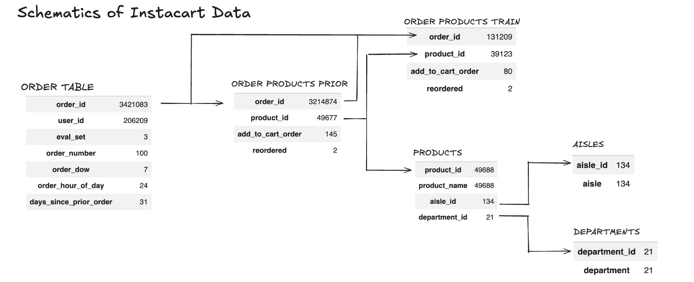

# Instacart-Data-Analysis
Analysis of "Instacart Market Basket" data sourced from Kaggle.

## Project Overview 
This project analyzes customer purchasing behavior using the **Instacart Market Basket Analysis** dataset to identify patterns in what customers buy, what they repeatedly purchase, which products and departments are commonly purchased together, and when customers are most active.

The goal was to move beyond simple product rankings and use customer behavior to develop a **data-driven grocery store layout strategy**.

The analysis combines:

* Product and department purchasing behavior
* Product and department co-purchases
* Product association using lift
* Reorder behavior
* Day-of-week shopping patterns
* Hourly shopping activity

The final objective is to translate these findings into actionable recommendations for **product placement, department adjacency, cross-selling, inventory planning, and store traffic management**.

---

## Business Question

> **How can customer purchasing behavior be used to optimize grocery store layout and make shopping more efficient?**

Traditional grocery store layouts are often organized primarily by product category. This project investigates whether customer transaction data can provide a more effective approach by considering **how shoppers actually purchase products across aisles and departments**.

---

## Tools & Technologies
* Google Colabs
* Python and libraries (pandas, plotly, seaborn)
* Dataset: **Instacart Market Basket Analysis**

---

## Analytical Framework

```text
                    CUSTOMER DATA
                         │
          ┌──────────────┼──────────────┐
          ↓              ↓              ↓
      WHAT THEY      WHAT THEY       WHEN THEY
        BUY          BUY AGAIN        SHOP
          │              │              │
          ↓              ↓              ↓
     Department       Reorder       Day / Hour
      Analysis          Rate         Analysis
          │
          ↓
   WHAT THEY BUY TOGETHER
          │
          ↓
   Product / Department
      Co-purchase
          │
          ↓
     HIGH-LIFT PAIRS
          │
          ↓
   DATA-DRIVEN STORE
        LAYOUT
```

---

## Dataset

This project uses the publicly available **Instacart Market Basket Analysis** dataset.

Primary datasets:

* `orders.csv`
* `products.csv`
* `aisles.csv`
* `departments.csv`
* `order_products__prior.csv`
* `order_products__train.csv`



A combined `user_products` table was created containing:

```text
user_id
order_id
product_id
product_name
reordered
aisle
department
```

The analysis primarily uses historical prior-order purchasing data to examine customer behavior.

---

# Analysis

## 1. Product & Department Purchasing Behavior

The first stage of analysis following data validation was identifying which products, aisles, and departments account for the greatest amount of purchasing activity.

This establishes the overall demand structure of the store and helps distinguish:

* High-demand products
* High-demand departments
* High-demand aisles
* Lower-performing departments
* Frequently purchased products

### Key Results

**Produce was the highest-volume department**, accounting for **29.23% of total purchases**, followed by Dairy Eggs at **16.69%**.

The top-selling products were heavily concentrated in Produce. The highest-volume products included:

| Rank | Product | Purchases | Reorder Rate |
|---:|---|---:|---:|
| 1 | Banana | 472,565 | 84.35% |
| 2 | Bag of Organic Bananas | 379,450 | 83.26% |
| 3 | Organic Strawberries | 264,683 | 77.77% |
| 4 | Organic Baby Spinach | 241,921 | 77.25% |
| 5 | Organic Hass Avocado | 213,584 | 79.66% |

The highest-volume aisles were also concentrated around fresh food:

* **Fresh Fruits:** 11.23% of purchases
* **Fresh Vegetables:** 10.54%
* **Packaged Vegetables & Fruits:** 5.44%
* **Yogurt:** 4.48%
* **Packaged Cheese:** 3.02%
* **Milk:** 2.75%

### Business Insight

Produce represents the strongest source of customer demand and should receive sufficient store space, inventory availability, and accessibility.

The concentration of top-selling products within Produce also suggests that Produce should be treated as a central component of the store layout.

---

## 2. Department Co-Purchase Analysis

Products were grouped by department to determine which departments commonly appear together within customer orders.

This analysis answers:

> **Which departments are commonly represented in the same shopping basket?**

Strong department relationships can inform:

* Department adjacency
* Cross-selling
* Promotional placement
* Store navigation

### Key Results

Department co-purchase analysis was performed using the **top 600 products**.

The strongest department relationships were:

| Rank | Department Pair | Co-Purchase Count | % of Total |
|---:|---|---:|---:|
| 1 | Dairy Eggs ↔ Produce | 10,684,834 | 31.39% |
| 2 | Beverages ↔ Produce | 2,575,490 | 7.57% |
| 3 | Frozen ↔ Produce | 2,115,697 | 6.21% |
| 4 | Produce ↔ Snacks | 1,703,614 | 5.00% |
| 5 | Canned Goods ↔ Produce | 1,676,777 | 4.90% |
| 6 | Deli ↔ Produce | 1,642,464 | 4.82% |
| 7 | Pantry ↔ Produce | 1,530,236 | 4.49% |
| 8 | Meat Seafood ↔ Produce | 1,214,061 | 3.57% |
| 9 | Beverages ↔ Dairy Eggs | 1,033,742 | 3.04% |
| 10 | Bakery ↔ Produce | 958,148 | 2.81% |

The **Dairy Eggs ↔ Produce** relationship was substantially stronger than the other department relationships, accounting for **10.68 million co-purchases and 31.39% of observed department co-purchases**.

Produce also appeared in **8 of the top 10 department relationships**.

### Business Insight

Produce functions as a central component of customer baskets.

The strongest opportunity for department adjacency is therefore between **Produce and Dairy Eggs**, particularly for complementary purchases such as yogurt and fruit.

---

## 3. Product Co-Purchase Analysis

Product-level basket analysis was used to identify products that customers frequently purchase together.

The analysis includes:

* Co-purchase count
* Support
* Support %
* Confidence
* Lift
* Same-aisle relationships

### Lift

Lift measures how strongly two products are associated relative to what would be expected based on their individual purchase frequencies.

A lift greater than 1 indicates that two products are purchased together more frequently than would be expected if their purchases were independent.

High-lift product pairs can be used for:

* Adjacent product placement
* Cross-selling
* Product recommendations
* Promotional bundles

### Business Insight

High-lift product pairs identify **complementary purchasing relationships** that may not be apparent from individual product sales alone.

These products represent potential candidates for:

* Side-by-side placement
* End-cap displays
* Cross-merchandising
* Digital recommendations

This allows product placement decisions to be based on observed customer purchasing behavior rather than solely on traditional product categories.

---

## 4. Aisle Relationships

Product pairs were evaluated based on whether the products belonged to the same aisle.

A total of **55,828,269 product co-purchases** were analyzed.

| Relationship | Co-Purchase Count | % |
|---|---:|---:|
| Same aisle | 7,581,152 | 13.58% |
| Different aisles | 48,247,117 | 86.42% |
| **Total** | **55,828,269** | **100%** |

Approximately **13.58% of observed co-purchase activity occurred within the same aisle**, while **86.42% occurred across different aisles**.

### Business Insight

This is an important finding for store layout.

The majority of observed product relationships occur **across aisle boundaries**, suggesting that customers' purchasing relationships extend beyond traditional category organization.

Therefore, store layout should not only group similar products together. It should also consider **strong relationships between products located in different aisles**.

For example, if two products demonstrate high lift but are located in separate areas of the store, they could be evaluated for closer placement or cross-merchandising.

---

## 5. Reorder Rate Analysis

Reorder behavior was analyzed to identify products that customers repeatedly purchase.

Reorder rate provides a different perspective from total purchase volume.

While purchase volume answers:

> **What is purchased frequently?**

Reorder behavior answers:

> **What do customers repeatedly come back for?**

### Key Results

Several of the highest-volume products also had high reorder rates:

| Product | Purchases | Reorder Rate |
|---|---:|---:|
| Banana | 472,565 | 84.35% |
| Bag of Organic Bananas | 379,450 | 83.26% |
| Organic Strawberries | 264,683 | 77.77% |
| Organic Baby Spinach | 241,921 | 77.25% |
| Organic Hass Avocado | 213,584 | 79.66% |
| Organic Avocado | 176,815 | 75.81% |

Bananas were the highest-volume product with **472,565 purchases** and an **84.35% reorder rate**.

### Business Insight

High reorder rates among high-volume products indicate strong repeat-purchase behavior.

These products represent established customer habits and should be:

* Easy to locate
* Consistently positioned
* Easily accessible
* Adequately stocked

This can reduce search time and improve convenience for repeat customers.

---

## 6. Customer Shopping Habits

Customer ordering activity was analyzed by:

* Day of week
* Hour of day

This identifies periods when customer activity is higher or lower.

### Business Applications

These patterns can support:

* Staffing decisions
* Inventory planning
* Restocking schedules
* Traffic management
* Promotion timing
* Checkout capacity

### Business Insight

Customer demand varies throughout the day and week rather than remaining constant.

Identifying periods of higher activity allows store operations to better align staffing, inventory replenishment, and traffic management with customer demand.

---

# Key Findings

The six analyses reveal several consistent patterns in customer behavior:

### 1. Produce is the dominant department

Produce accounted for **29.23% of total purchases**, making it the highest-volume department.

### 2. Produce is central to customer baskets

Produce appeared in **8 of the top 10 department co-purchase relationships**.

### 3. Dairy Eggs and Produce have the strongest department relationship

The Dairy Eggs ↔ Produce combination generated **10,684,834 co-purchases**, representing **31.39% of observed department co-purchases** within the top 600 products.

### 4. Fresh Fruits and Fresh Vegetables are the highest-volume aisles

Fresh Fruits accounted for **11.23%** of total purchases made, while Fresh Vegetables accounted for **10.54%**.

### 5. Most product relationships cross aisle boundaries

Only **13.58%** of co-purchases occurred within the same aisle, compared with **86.42% across different aisles**.

### 6. High-demand products are frequently reordered

Top products such as bananas showed reorder rates above **80%**, demonstrating strong repeat-purchase behavior.

### 7. Customer activity follows temporal patterns

Day-of-week and hourly analysis identified patterns in customer activity that can be used to improve store operations.

---

# Data-Driven Store Layout Strategy

The findings can be translated into several store-layout recommendations.

## 1. Prioritize Produce

Produce should receive significant floor space and accessibility because it:

* Represents the largest department by purchase volume
* Contains many of the highest-selling products
* Appears in 8 of the top 10 department co-purchase relationships

---

## 2. Position Dairy Eggs Near Produce

The **Dairy Eggs ↔ Produce** relationship was the strongest department association identified.

This creates an opportunity to make complementary purchases more convenient, particularly:

**Yogurt + Fruit**

Other complementary relationships can be evaluated using the product-level lift analysis.

---

## 3. Use High-Lift Product Pairs for Cross-Merchandising

Products with high lift should be evaluated for:

* Adjacent placement
* End-cap displays
* Promotional bundles
* Digital recommendations

The objective is to reduce shopping friction while encouraging complementary purchases.

---

## 4. Consider Cross-Aisle Relationships

Because **86.42% of observed co-purchases occurred across different aisles**, store planning should consider relationships that extend beyond individual aisles.

Strong cross-aisle product relationships can be candidates for:

* Closer aisle placement
* Secondary displays
* Cross-merchandising
* In-store signage

---

## 5. Keep High-Reorder Products Accessible

Frequently reordered products should be easy to locate and consistently positioned.

This is especially important for high-volume staples that customers purchase repeatedly.

---

## 6. Use Shopping Patterns to Optimize Operations

Day-of-week and hourly activity can be used to determine when additional resources are needed.

For example:

* Increase staffing during peak periods
* Restock high-demand products before peak activity
* Minimize aisle obstructions
* Adjust checkout capacity
* Schedule promotions around customer activity

---

# Proposed Store Layout Concept

The analysis suggests organizing the store around **customer purchasing relationships**, rather than relying exclusively on traditional product categorization.

```
                                      BACK OF STORE
┌─────────────────────────────────────────────────────────────────────────────────────────────┐
│                                                                                             │
│   FROZEN                    MEAT SEAFOOD                    PANTRY             CANNED GOODS │
│                                                                                             │
│  34 Frozen Meat Seafood     7 Packaged Meat                 5 Marinades         59 Canned   │
│  37 Ice Cream               15 Packaged Seafood             17 Baking           69 Soup     │
│  38 Frozen Meals            35 Poultry Counter              19 Oils/Vinegars    81 Canned   │
│  42 Vegan/Vegetarian        39 Seafood Counter              29 Honey/Syrups     95 Canned   │
│  52 Frozen Breakfast        49 Packaged Poultry             51 Dips/Spreads     99 Canned   │
│  58 Frozen Breads/Doughs   106 Hot Dogs/Bacon/Sausage       72 Condiments                   │
│  79 Frozen Pizza           122 Meat Counter                 88 Spreads                      │
│ 113 Frozen Juice                                            89 Salad Dressing               │
│ 116 Frozen Produce                                          97 Baking Supplies              │
│ 119 Frozen Dessert                                          104 Spices/Seasonings           │
│ 129 Frozen Appetizers/Sides                                 105 Doughs/Bake Mixes           │
│                                                             110 Pickled Goods               │
├───────────────────────────────┬───────────────────────────────┬─────────────────────────────┤
│                               │                               │                             │
│       BEVERAGES               │          DAIRY EGGS           │          PRODUCE            │
│                               │                               │                             │
│ 26 Coffee                     │ 2 Specialty Cheese            │ 16 Fresh Herbs              │
│ 31 Refrigerated               │ 21 Packaged Cheese            │ 24 Fresh Fruits             │
│ 64 Energy/Sports Drinks       │ 36 Butter                     │ 32 Packaged Produce         │
│ 77 Soft Drinks                │ 53 Cream                      │ 83 Fresh Vegetables         │
│ 90 Cocoa/Drink Mixes          │ 71 Pudding/Desserts           │ 123 Packaged Veg/Fruits     │
│ 94 Tea                        │ 84 Milk                       │                             │
│ 98 Juice Nectars              │ 86 Eggs                       │                             │
│ 115 Water/Seltzer             │ 91 Soy/Lactosefree            │                             │
│                               │ 108 Other Creams/Cheeses      │                             │
│                               │ 120 Yogurt ★                  │                             │
│                               │                               │                             │
├───────────────────────────────┼───────────────────────────────┼─────────────────────────────┤
│                               │                               │                             │
│         SNACKS                │        BREAKFAST / BAKERY     │        DELI                 │
│                               │                               │                             │
│ 3 Energy/Granola Bars         │ 48 Breakfast Bars/Pastries    │ 1 Prepared Soups/Salads     │
│ 23 Popcorn/Jerky              │ 57 Granola                    │ 13 Prepared Meals           │
│ 45 Candy/Chocolate            │ 121 Cereal                    │ 14 Tofu/Meat Alternatives   │
│ 46 Mint/Gum                   │ 130 Hot Cereal/Pancake Mixes  │ 67 Fresh Dips/Tapenades     │
│ 50 Fruit/Vegetable Snacks     │                               │ 96 Lunch Meat               │
│ 61 Cookies/Cakes              │                               │                             │
│ 78 Crackers                   │                               │                             │
│ 103 Ice Cream Toppings        │                               │                             │
│ 107 Chips/Pretzels            │                               │                             │
│ 117 Nuts/Seeds/Dried Fruit    │                               │                             │
│ 125 Trail Mix                 │                               │                             │
│                               │                               │                             │
├───────────────────────────────┴───────────────────────────────┴─────────────────────────────┤
│                                                                                             │
│                    PANTRY / DRY GOODS / INTERNATIONAL / BAKERY                              │
│                                                                                             │
│  DRY GOODS PASTA          INTERNATIONAL          BAKERY              BULK                   │
│                                                                                             │
│  4 Instant Foods           30 Latino Foods        8 Bakery Desserts    18 Bulk Dried        │
│  9 Pasta Sauce             33 Kosher Foods       43 Buns/Rolls         68 Bulk Grains       │
│ 12 Fresh Pasta             66 Asian Foods        93 Breakfast Bakery                        │
│ 63 Grains/Rice             76 Indian Foods      112 Bread                                   │
│131 Dry Pasta                                    128 Tortillas/Flat Bread                    │
│                                                                                             │
├─────────────────────────────────────────────────────────────────────────────────────────────┤
│                                                                                             │
│  PERSONAL CARE       HOUSEHOLD            BABIES          PETS           ALCOHOL            │
│                                                                                             │
│ 11 Cold/Flu/Allergy  10 Kitchen Supplies  56 Diapers      40 Dog Food    27 Beer/Coolers    │
│ 20 Oral Hygiene      54 Paper Goods       82 Baby Access. 41 Cat Food    28 Red Wine        │
│ 22 Hair Care         60 Trash Bags        92 Baby Food    62 White Wine  124 Spirits        │
│ 25 Soap              74 Dish Detergent   102 Baby Bath    134 Specialty  134 Specialty      │
│ 44 Eye/Ear Care      75 Laundry              /Body Care       Wine/Champagne                │
│ 47 Vitamins          85 Food Storage                                                        │
│ 55 Shave Needs       87 More Household                                                      │
│ 65 Protein Meals    101 Air Fresheners                                                      │
│ 70 Digestion        111 Plates/Cups                                                         │
│ 73 Facial Care      114 Cleaning Products                                                   │
│ 80 Deodorants                                                                               │
│109 Skin Care                                                                                │
│118 First Aid                                                                                │
│126 Feminine Care                                                                            │
│127 Body Lotion/Soap                                                                         │
│132 Beauty                                                                                   │
│133 Muscle/Joint/Pain                                                                        │
│                                                                                             │
├─────────────────────────────────────────────────────────────────────────────────────────────┤
│                                                                                             │
│                         CHECKOUT / IMPULSE / QUICK-PICK                                     │
│                                                                                             │
│              HIGH-REORDER PRODUCTS       TOP SELLERS       PROMOTIONAL ITEMS                │
│                                                                                             │
└─────────────────────────────────────────────────────────────────────────────────────────────┘
                                       FRONT / ENTRANCE

```

This is a **conceptual recommendation**, not a claim that the analysis proves a single optimal floorplan.

The purpose is to demonstrate how transaction data can inform physical store design.

---

# Recommendations

Based on the analysis, a grocery retailer could:

1. **Position strongly co-purchased departments closer together.**
2. **Use high-lift product pairs to guide cross-merchandising.**
3. **Keep high-reorder products easily accessible.**
4. **Consider cross-aisle purchasing relationships when designing aisle placement.**
5. **Use shopping-time patterns to improve staffing and inventory planning.**
6. **Reduce space or reconsider placement for consistently low-performing areas.**
7. **Use purchasing data continuously to refine the store layout rather than treating the layout as static.**

---

# Project Outcome

This project demonstrates how transactional customer data can be transformed into practical business recommendations.

Rather than only identifying the products that sell the most, the analysis considers:

```text
WHAT customers buy
        +
WHAT they buy together
        +
WHAT they repeatedly buy
        +
WHEN they shop
        ↓
DATA-DRIVEN STORE STRATEGY
```

The key takeaway is that **customer purchasing relationships can provide a foundation for optimizing product placement, department adjacency, cross-selling, inventory planning, and the overall shopping experience.**

---

# Tools & Technologies

* Python
* Pandas
* NumPy
* Matplotlib
* Seaborn
* Google Colab
* Kaggle

### Analytical Techniques

* Data cleaning
* Data aggregation
* GroupBy analysis
* Product ranking
* Reorder rate analysis
* Market basket analysis
* Co-purchase analysis
* Support
* Confidence
* Lift
* Temporal analysis
* Data visualization

---

# Future Improvements

Potential next steps include:

* Incorporating actual store floor dimensions
* Modeling customer walking distance
* Incorporating product profitability
* Testing alternative store layouts
* Developing a recommendation engine for complementary products and recipes
* Building an interactive Tableau or Power BI dashboard
* Applying clustering to identify different customer shopping patterns

---

# Project Structure

```text
instacart-market-basket-analysis/
│
├── notebooks/
│   ├── 01_initial_data_validation.ipynb
│   ├── 02_reordered_products.ipynb
│   └── 03_basket_analysis.ipynb
│
├── excalidraw/
│   ├── analysis_result_tables/
│   ├── co_purchase_basket_analysis/
│   ├── product_performance/
│   ├── project_planning/
│   └── table_schematics/
│
├── images/
│   ├── top_products.png
│   ├── department_purchases.png
│   ├── aisle_purchases.png
│   ├── department_copurchases.png
│   ├── product_lift.png
│   ├── reorder_rate.png
│   └── shopping_activity.png
│
├── README.md
└── requirements.txt
```

---


Data Analytics Portfolio Project

**Focus Areas:** 
Data Analysis · Customer Behavior · Market Basket Analysis · Business Intelligence · Retail Analytics
